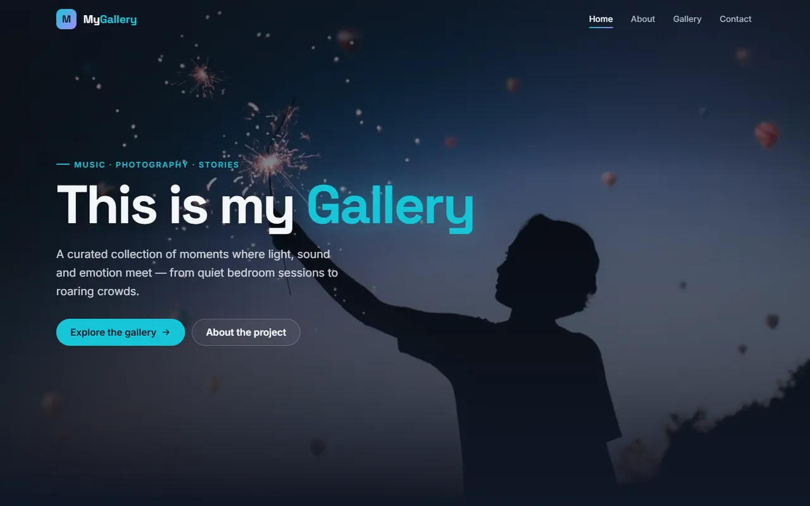
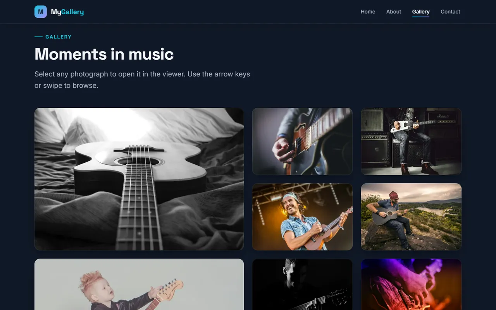
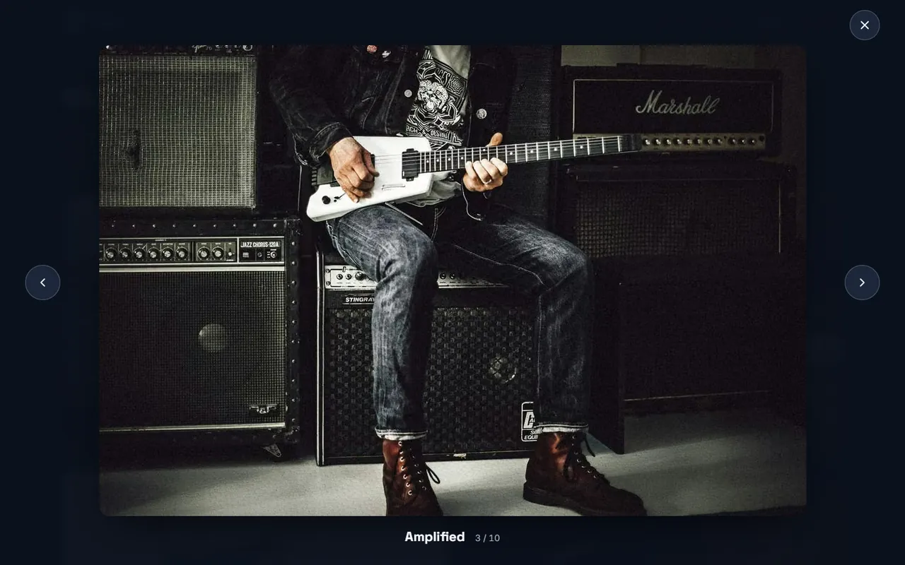
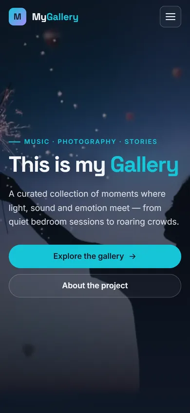
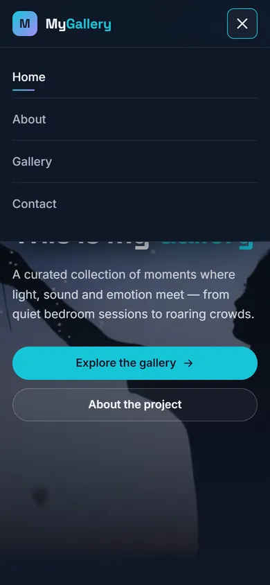

<div align="center">

# MyGallery — Music & Photography

**A responsive, accessible and performance-focused photo gallery built with vanilla HTML, CSS and JavaScript.**




</div>

## Overview

MyGallery is a single-page photography portfolio with a dark, modern design. It started as a Flexbox exercise and was later redesigned into a production-quality front-end project focused on:

- a consistent **design system** built entirely on CSS custom properties,
- a **mobile-first** layout that adapts from 320px phones to ultrawide displays,
- **accessibility** (WCAG-oriented semantics, keyboard support, reduced motion),
- **performance** (modern image formats, responsive images, minimal JavaScript),
- **progressive enhancement** — the site remains fully usable without JavaScript.

No framework, library or build tool is used. The aim is to show what the web platform can do on its own.

## Screenshots

| Gallery (desktop) | Lightbox viewer |
| :---: | :---: |
|  |  |

| Mobile — hero | Mobile — navigation |
| :---: | :---: |
|  |  |

## Features

### Interface
- **Hero section** with a full-bleed background image, a readability gradient overlay and a staggered entrance animation.
- **Sticky header** that gains a blurred background on scroll, with an animated link indicator and scroll-spy highlighting of the current section.
- **Bento gallery grid**: 1 column on phones, 2 columns from 480px, and a 4-column layout with featured tiles from 1024px.
- **Lightbox viewer** built on the native `<dialog>` element, with previous/next controls, arrow keys, swipe gestures and a position counter.
- **Scroll-reveal animations** with staggered timing, driven by `IntersectionObserver`.

### Accessibility
- Semantic landmarks (`header`, `nav`, `main`, `section`, `article`, `aside`, `footer`) and a correct heading hierarchy.
- Skip link, visible `:focus-visible` styles and keyboard support for every control.
- Mobile menu with `aria-expanded`/`aria-controls`, Escape to close and focus returned to the toggle.
- Lightbox with focus management, focus returned to the opening thumbnail and labelled controls.
- Descriptive `alt` text for every photograph.
- Full support for `prefers-reduced-motion`: all animations and smooth scrolling are disabled.

### Performance
- Every photo is served in **AVIF** and **WebP** with a **JPEG** fallback through `<picture>`, at 480 / 800 / 1125px via `srcset` and `sizes`.
- At 800px, the AVIF set is **~68% lighter** than the original JPEGs (225 KB vs 711 KB for all 11 images).
- Native `loading="lazy"` and `decoding="async"` for off-screen images; `fetchpriority="high"` for the hero image.
- Explicit `width`/`height` and `aspect-ratio` to prevent layout shift (CLS).
- A single `requestAnimationFrame`-throttled, passive scroll listener.
- Animations use only `transform` and `opacity`, so they stay on the compositor.
- One font request (Inter and Space Grotesk) with `preconnect` and `font-display: swap`.

## Tech stack

| Layer | Approach |
| --- | --- |
| Markup | Semantic HTML5, `<picture>`, native `<dialog>` |
| Styling | Modern CSS: custom properties, Grid, Flexbox, `clamp()`, `:has()`, `aspect-ratio` |
| Scripting | Vanilla JavaScript (ES6+) in a single IIFE, about 230 lines |
| Images | AVIF / WebP / JPEG variants generated with Python and Pillow |
| Fonts | Inter (body) and Space Grotesk (display) via Google Fonts |

## Design system

All visual decisions are stored as tokens in `:root`, which keeps the theme consistent and easy to change.

| Token | Value | Usage |
| --- | --- | --- |
| Deep Navy | `#101827` | Main background |
| Slate Blue | `#202D40` | Surfaces and cards |
| Electric Cyan | `#16C5D8` | Primary accent and interactive elements |
| Off White | `#F4F6FA` | Main text |
| Soft Violet | `#A78BFA` | Secondary accent |

Typography uses fluid `clamp()` sizes. Spacing, radii, shadows, easing curves and durations are also tokenized.

## Project structure

```
Template-website-my-Galery/
├── index.html              # Single-page markup
├── css/
│   └── style.css           # Tokens → base → utilities → components → motion
├── js/
│   └── main.js             # Header state, mobile nav, scroll reveal, lightbox
├── image/
│   ├── *.jpg / *.jpeg      # Original photographs (full-size fallback links)
│   └── optimized/          # Generated responsive variants (AVIF, WebP, JPEG)
└── docs/
    └── screenshots/        # README preview images
```

The stylesheet is organized into numbered sections: tokens, reset/base, utilities, buttons, header/nav, hero, features, about, gallery, lightbox, footer, motion.

## Getting started

No installation or build step is needed.

```bash
git clone https://github.com/svetlanavrabie/Template-website-my-Galery.git
cd Template-website-my-Galery
```

Then either open `index.html` directly in a browser, or serve it locally (recommended):

```bash
python -m http.server 8000
# open http://localhost:8000
```

### Deploying to GitHub Pages

1. Go to **Settings → Pages** in the repository.
2. Under **Build and deployment**, choose **Deploy from a branch**, then select `main` and `/ (root)`.
3. The site will be published at `https://<username>.github.io/Template-website-my-Galery/`.

## Responsive breakpoints

The layout is mobile-first, and breakpoints are defined in `em` so they respect the user's font size.

| Breakpoint | Layout change |
| --- | --- |
| < 480px | Single-column gallery, full-width hero buttons |
| ≥ 480px | Two-column gallery |
| < 768px | Hamburger navigation menu |
| ≥ 900px | Three-column features, two-column About section |
| ≥ 1024px | Four-column bento gallery with featured tiles |
| ≥ 1920px | Wider container and larger base font size for ultrawide screens |

Tested at 320, 375, 768, 1024, 1440 and 2560px with no horizontal overflow.

## Browser support

Works in all current evergreen browsers (Chrome, Edge, Firefox, Safari 15.4+). Older browsers degrade gracefully: images fall back to JPEG, and gallery links open the full-size photo directly.

## Roadmap

- [ ] Self-host the web fonts to remove the third-party request
- [ ] Add category filters to the gallery
- [ ] Add a contact form
- [ ] Add automated Lighthouse and accessibility checks in CI

## Author

**Svetlana Vrabie**
GitHub: [@svetlanavrabie](https://github.com/svetlanavrabie)

---

<div align="center">
<sub>© 2026 Svetlana Vrabie · Built with HTML5, CSS3 & JavaScript</sub>
</div>
